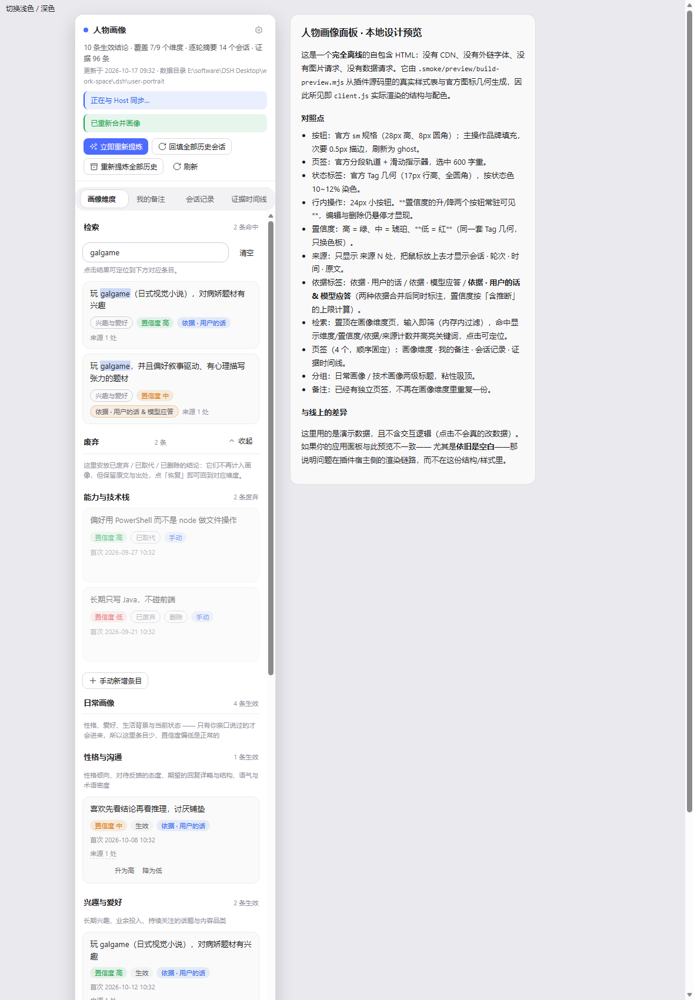

# dsh-user-portrait

> A DSH Host/Client plugin that turns what you raise in every session into a
> structured, reviewable portrait of you — and hands it back to the model on
> demand.

中文文档：[README.zh.md](./README.zh.md)



## What it does

- **Per-turn extraction.** After each turn a background job asks the model for a
  short “what I asked / what you answered” digest plus tagged evidence. The
  digest is stored per turn; evidence is appended to a ledger.
- **Nine dimensions in two groups.** Daily life (personality & communication,
  interests, background, current focus, recent state) and technical (skills &
  stack, working style, boundaries, sensitivities). Every conclusion carries a
  confidence level, a basis (your words / the model's answer / both), and its
  sources.
- **A review panel**, not a black box: four tabs (dimensions, my notes, session
  log, evidence timeline), inline editing, confidence up/down, a discard area
  with reversible deletes, search, export to Markdown, and a per-conclusion cap.
- **Four tools for the model**: `portrait_read`, `portrait_search`,
  `portrait_history`, `portrait_maintain` (corrections, notes, backfill,
  re-digest, synthesize now).
- **Opt-in prompt hint.** Off for every new session. Turning it on next to the
  permission selector injects a short “a portrait is available” note; the
  conclusions stay behind the tools, so a stale summary cannot steer the current
  turn.
- **Local, plain text.** Everything lives in `<DSH_HOME>/user-portrait` (or
  `~/.dsh/user-portrait`): `profile.json`, `profile.md`, `evidence.jsonl`,
  per-session and per-turn records, and a `deleted.log` audit trail. Back it up,
  diff it, or hand-edit it.

## Install

```powershell
# A regular dsh web profile
dsh plugin --profile web add dsh-user-portrait

# The desktop app: the marketplace installs an exact version
dsh plugin --profile desktop add dsh-user-portrait@1.1.0
```

Reload the plugin (or restart DSH). No build step and no extra dependencies:
the plugin is plain ESM and imports nothing outside the runtime.

Requires DSH `>= 0.2.0-rc.2` (the desktop app reports this as `0.2.1-rc.x`)
and Node.js 20 or newer.

## Using it

- **Right sidebar → “User Portrait”** tab, the portrait button in the session
  header, or Settings → User Portrait.
- The first run starts from an empty portrait. Each finished turn adds to it;
  use **Synthesize now** to merge the existing ledger immediately, or **Backfill
  all sessions** to process history (off by default).
- Deletes are two-level: a dimension card *retires* a conclusion (restorable
  from the discard area), while the discard area's *permanent delete* removes it
  and pins its evidence so a later re-digest cannot resurrect it.

## Configuration

Set these in the plugin's patch (`cordis.patch.yml`); changing them needs a
reload or restart.

| Key | Default | Meaning |
|---|---|---|
| `dataDir` | `""` → `<DSH_HOME>/user-portrait` | Where the portrait is stored. A relative path resolves against the Host's working directory. |
| `enabled` | `true` | Master switch. |
| `loadHint` | `true` | Allow the “portrait is available” system-prompt section; each session still has to switch the hint on. |
| `backfillOnStart` | `true` (shipped patch: `false`) | Process history on startup. |
| `synthesizeEveryTurns` | `1` | Merge the portrait every N turns (`0` disables automatic merging). |
| `turnSynthesisDelayMs` | `3000` | Coalescing window for the per-turn merge. |
| `minEvidenceForSynthesis` | `3` | Skip a merge with fewer new evidence rows. |
| `rollupOnDispose` | `true` | Rewrite a session roll-up when its agent is disposed. |
| `provider` / `model` | `""` | Model route for background extraction; empty means the current default model. |
| `feedbackUrl` | `""` | Target of the panel's feedback button; empty keeps it disabled. |

## Privacy

- The plugin reads full session transcripts to extract evidence, and sends the
  digests/prompts it builds to the model provider DSH is configured with. It
  makes no other network requests.
- Secrets are masked (`sk-`, `ghp_`, `AKIA`, JWTs, private keys,
  `password=`) before anything is written or sent.
- Portrait data never leaves the machine except through those model calls.

## Development

```powershell
npm test                          # all twelve suites
node test/portrait-harness.mjs    # one suite
```

All twelve suites share one assertion helper (`test/_harness.mjs`) and resolve
every path from `test/_paths.mjs`; `npm run check:package` fails if a
machine-specific path leaks into `test/`. Set `DSH_APP_ROOT` to the unpacked desktop app
to run the suites that use the runtime's schema validators and React; set
`PORTRAIT_DATA` to a portrait directory to replay real data. Without them those
suites print `SKIP` instead of passing silently.

See [CHANGELOG.md](./CHANGELOG.md) for version history.

## License

MIT © 2026 loliisgood
