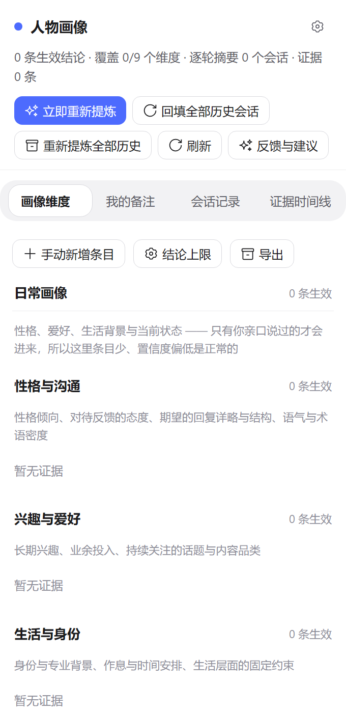

# 人物画像 · User Portrait

> 一个 DSH Host/Client 双向插件：从日常对话与工作总结中提炼你的习惯、技能与偏好，形成可核对、可纠正的人物画像——既能作为简历与自我总结的参考资料，也能按会话注入提示词，让模型更了解你，回答更贴合你的想法与习惯。

[English](./README.md) · 中文



## 它做什么

- **每轮提炼**：每轮结束后台调用模型，生成「我问的 / 要点 / 你答的 / 纠正与偏好」摘要，并把证据写入账本；这一轮没有新证据时不调用模型。
- **9 个维度**：日常画像（性格与沟通、兴趣与爱好、生活与身份、当前在做、近期状态）和技术画像（能力与技术栈、工作方式、风险边界、敏感点）。
- **可作简历 / 自我总结的参考资料**：能力与技术栈、工作方式、背景等维度按证据累积，可导出 Markdown。
- **每条结论可核对**：带置信度、依据（用户的话 / 模型应答 / 两者合并）与来源会话；同类结论优先合并，冲突时旧条目标为已取代。
- **可审阅、可纠正**：右栏面板有四个页签（画像维度、我的备注、会话记录、证据时间线），支持编辑、升降置信度、废弃与恢复、永久删除、检索、导出 Markdown 和结论上限。
- **四个模型工具**：`portrait_read`、`portrait_search`、`portrait_history`、`portrait_maintain`。
- **提示按会话开启**：默认不把画像注入系统提示；在输入框旁打开开关后，才注入一小段「画像可用」说明。

## 安装

```powershell
# 普通 dsh web 环境
dsh plugin --profile web add dsh-user-portrait

# 桌面版：市场一键安装也是精确版本
dsh plugin --profile desktop add dsh-user-portrait@0.1.0
```

重启 DSH，或在插件管理器里重载。插件是纯 ESM，没有构建步骤，也没有额外依赖。

## 用起来

- 入口：右栏「人物画像」页签、会话头部「画像」按钮、设置 →「人物画像」。
- **画像维度**：顶部是检索、手动新增、结论上限、导出，下面是日常画像与技术画像两组。
- **我的备注**：备注优先级最高，自动提炼不会覆盖。
- **会话记录**：会话级概要 + 逐轮「我问 / 你答」。
- **证据时间线**：证据账本，可核对原文。
- **删除分两级**：维度卡片上的删除 = 标记废弃（可恢复）；废弃区的永久删除 = 物理删除并拉黑相关证据（需二次确认）。

| 工具 | 作用 |
|---|---|
| `portrait_read` | 读取画像，可按 `dimension` 过滤、用 `includeRetired` 看历史 |
| `portrait_search` | 在证据与逐轮记录里按关键词检索 |
| `portrait_history` | 读取会话概要与会话内的逐轮要点 |
| `portrait_maintain` | 手动纠正、增删备注，以及 `backfill` / `redigest` / `synthesizeNow` |

## 配置

写在 [cordis.patch.yml](./cordis.patch.yml) 里，改完重启生效。

| 键 | 默认 | 说明 |
|---|---|---|
| `dataDir` | 空（→ `DSH_HOME/user-portrait`） | 画像数据目录；可填相对或绝对路径 |
| `enabled` | `true` | 总开关 |
| `loadHint` | `true` | 允许注入「画像可用」提示段；每个会话还要单独打开开关 |
| `backfillOnStart` | `true`（随包补丁为 `false`） | 启动时回填历史会话 |
| `synthesizeEveryTurns` | `1` | 每积累多少轮合并一次画像（`0` = 不自动合并） |
| `turnSynthesisDelayMs` | `3000` | 每轮提炼的合并窗口（毫秒） |
| `minEvidenceForSynthesis` | `3` | 少于这么多条新证据就跳过合并 |
| `rollupOnDispose` | `true` | 会话结束时用模型重写会话概要 |
| `sessionRollupMinTurns` | `3` | 少于这么多轮的会话不写模型概要 |
| `provider` / `model` | 空 | 后台提炼的模型路由；都留空则沿用当前默认模型 |
| `feedbackUrl` | 空 | 「反馈与建议」按钮的地址；留空则按钮禁用 |
| `limits.perUserMessage` | `6000` | 单条用户消息送入提炼前的字符上限 |
| `limits.perAssistantTurn` | `4000` | 单轮回答送入提炼前的字符上限 |
| `limits.synthesisEvidence` | `80` | 单次合并最多喂入多少条证据 |
| `limits.maxOutputTokens` | `4000` | 提炼调用的输出上限；触顶即丢弃该次结果 |

## 数据与隐私

- 数据目录默认是 `<DSH_HOME>/user-portrait`（未设置 `DSH_HOME` 时为 `~/.dsh/user-portrait`）。
- 全部是纯文本：`profile.json`、`profile.md`、`evidence.jsonl`、`state.json`、`blacklist.json`、`deleted.log`，以及 `sessions/`、`turns/`、`views/`。
- 会读取完整会话内容，并把提炼提示发给当前配置的模型；除此之外不发起网络请求。
- 写入和发送前会脱敏 `sk-`、`ghp_`、`AKIA`、JWT、私钥、`password=` 等凭据。

## 许可

MIT © 2026 loliisgood
